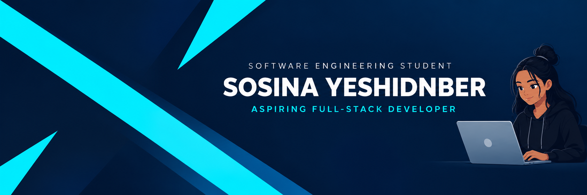

<h2 align="center">Hi there, I'm Sosina 👋</h2>

  

I enjoy learning how software works and building applications that solve real problems. I'm developing my skills in frontend and backend development, databases, and software engineering.

---

## 🤝 Connect with me

          

💬 Feel free to connect with me and discuss software development, projects, and new ideas.

---

## 🔭 I'm currently working on

- 🏨 **Betora HMS** — A hotel management system using a modular monolith architecture.
- 🏫 **EduBridge** — An education information and management platform.
- 💡 Improving my coding skills through practical projects.

---

### 🧰 Tech Stack

**Languages**

**Frontend**

**Backend & Database**

**Tools**

## 🛠️ Tech Stack

---

### 🚀 Featured Projects

#### 🏫 EduBridge
An education monitoring and information platform designed to support communication and decision-making across educational institutions.

**Technologies:** Next.js, React, Node.js, Express, Prisma, PostgreSQL

**Technologies:** Django, PostgreSQL, HTML, CSS

#### 📱 QR Attendance System
A team project focused on managing attendance using QR codes and role-based access for administrators, teachers, and students.

---

### 📊 GitHub Statistics

---

### 🤝 Connect With Me

---

⭐ *Always learning, building, and improving.*

